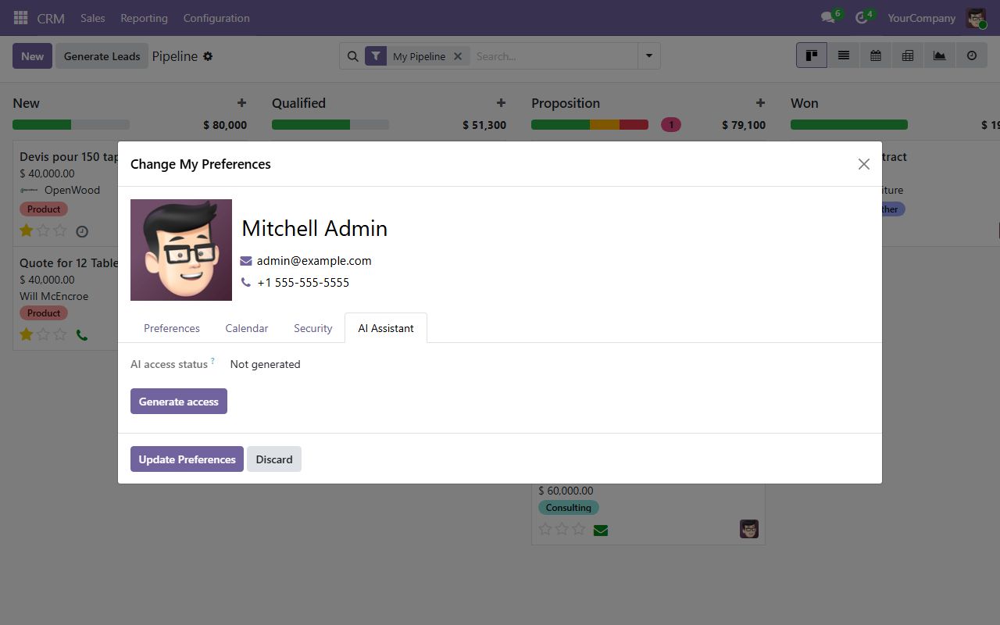
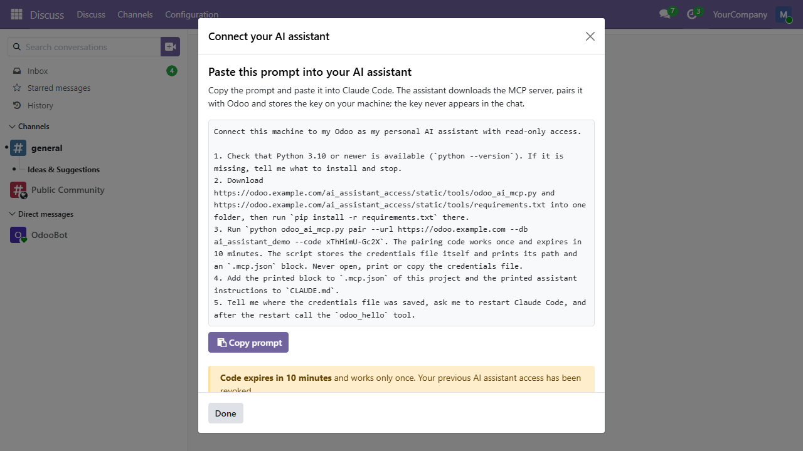
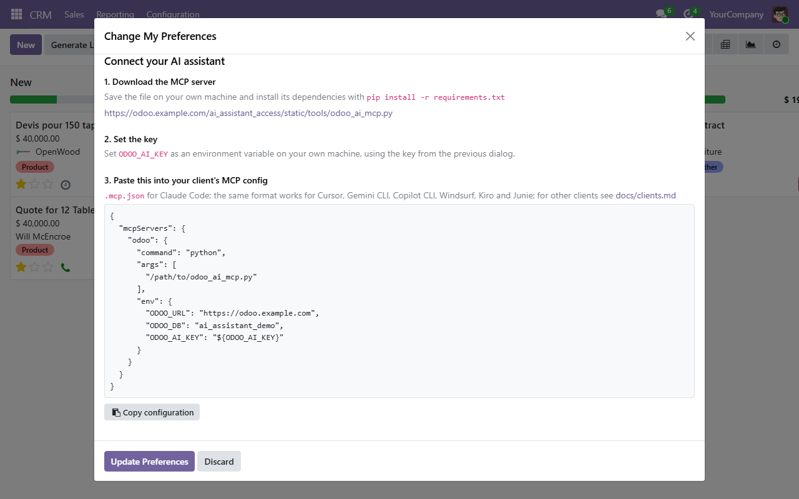

# User guide

This guide walks you through connecting your own AI assistant to your own Odoo data - exactly what
you see in the UI, nothing more.

## 3 steps to get started

### 1. Generate a pairing prompt

Go to **Preferences (avatar, top right) > "AI Assistant" tab** and click **"Generate read access"**.
Odoo asks you to re-enter your password (same protection as generating a native API key). When
your administrator turned on **Allow editing**, a second button **"Generate read and edit access"**
is shown.



A dialog shows a prompt with a one-time pairing code. Click **"Copy prompt"**. The code has 12
characters, works once and expires in 10 minutes. Generating a prompt revokes your previous AI
assistant access.



### 2. Paste the prompt into Claude Code

The assistant checks Python, downloads `odoo_ai_mcp.py` and `requirements.txt`, runs
`pip install -r requirements.txt` and then:

```bash
python odoo_ai_mcp.py pair --url https://your-instance --db your_database --code <code>
```

The script fetches your key directly from Odoo and stores it in a credentials file only you can
read (Windows `%APPDATA%\odoo-ai\<host>_<db>.json`, macOS
`~/Library/Application Support/odoo-ai/<host>_<db>.json`, Linux `~/.config/odoo-ai/<host>_<db>.json`
with mode `0600`). It prints the file path, an `.mcp.json` block with `ODOO_AI_CREDENTIALS` and the
assistant instructions for your access mode. The key never appears in the browser or in the chat.
If the code expired or was already used, the script reports "invalid or expired code"; generate a
new prompt.

### 3. Restart Claude Code

After the restart the assistant calls `odoo_hello`; you get one notification in your Odoo inbox
and the tab shows **Active** with the expiry date.



Other clients than Claude Code: see [docs/clients.md](clients.md) for the equivalent config file.

## What the assistant can and cannot do

- With read access it sees exactly what you see in Odoo (your access rights and record rules) and
  never writes anything except the `hello` notification.
- With read and edit access, and only while your administrator keeps **Allow editing** on, it can
  also create one record (`odoo_create`) or update up to 50 records (`odoo_write`) in the writable
  models (default `crm.lead`, `project.task`, `mail.activity`, `res.partner`), always as you.
- Even with **Allow editing** on, it can never delete, archive (`active`), change companies, send
  one2many/many2many commands or write binary and secret fields.
- When the administrator turns **Allow editing** off, your access keeps reading and every write is
  rejected with "writing is disabled by the administrator".

## Revoking access

- Preferences > AI Assistant > **"Revoke access"** deletes the key immediately.
- To invalidate a credentials file, revoke the key (the file becomes useless) and delete the file;
  `odoo_status` shows its path.

## Advanced: environment variable instead of a credentials file

For headless or scheduled setups you can skip `pair` and set `ODOO_URL`, `ODOO_DB` and
`ODOO_AI_KEY` in the MCP server environment (`export ODOO_AI_KEY=...` on macOS/Linux,
`setx ODOO_AI_KEY ...` on Windows). `ODOO_AI_KEY` overrides the key from the credentials file. Keep
`"ODOO_AI_KEY": "${ODOO_AI_KEY}"` in `.mcp.json` so the raw key never lands in a file.

## When access stops working

| Situation | What to do |
|---|---|
| Key expired (default after 90 days) | Preferences > AI Assistant > "Generate read access" for a new prompt. The previous key is revoked automatically. |
| You revoked access yourself | Generate a new one the same way as step 1. |
| An admin revoked your access, or disabled the AI assistant globally | Contact your administrator; while disabled, every request fails regardless of key validity. |
| Your Odoo account was deactivated | The key stops working immediately. After reactivation, generate a new key (the old one was revoked). |
| Assistant reports "invalid access key" or similar | Check that `ODOO_AI_CREDENTIALS` points to the file printed by `pair`, or generate a new prompt (step 1). |
| Assistant reports a dotted field is not allowed (e.g. `partner_id.vat`) | Dotted paths in filters are deliberately rejected - ask it to read the target model in a separate query. |

## Data protection

Data the assistant reads goes only into your own AI client session - Odoo does not send it
anywhere, there is no central account or third-party server involved on Odoo's side. If you use the
assistant on data belonging to other people (customers, contacts), see
[docs/security.md](security.md) for the note on data processing agreements.
