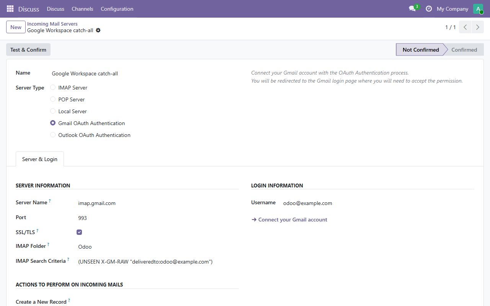

# Fetchmail IMAP Filter

Fetch only the IMAP mails matching a folder and a search criteria, instead of every unread mail in
the mailbox.

## Why

- **Fetch exactly what you configure, not every unread mail.** Odoo's core fetchmail always
  searches the whole `INBOX` for `(UNSEEN)`. This addon adds a folder and an IMAP search criteria
  per incoming mail server, so a fetch only pulls in the mails you actually want.
- **`UNSEEN` must lead the criteria.** A constraint rejects any criteria that does not start with
  `UNSEEN` (after optional leading parentheses), because top-level IMAP search keys are ANDed and
  only a leading `UNSEEN` reliably keeps already read mails out of every fetch.
- **Works for plain IMAP and for Gmail, with a dependency on `mail` only.** Gmail servers go
  through the same connection wrapper automatically; this addon never depends on `google_gmail`.
- **Built for the catch-all use case.** Route an unrecognized-address mail to a shared or personal
  mailbox and have Odoo pick up only the mails that actually belong to it - see
  [Gmail catch-all](#gmail-catch-all) below.

## Quick start

1. Install **Fetchmail IMAP Filter** (depends only on `mail`; install `google_gmail` as well if
   you connect a Gmail server).
2. **Settings > Technical > Incoming Mail Servers**, open or create an IMAP or Gmail server.
3. Set **IMAP Folder** (default `INBOX`) and **IMAP Search Criteria** (default `(UNSEEN)`).
4. Save. A criteria not starting with `UNSEEN`, e.g. `(ALL)` or `(NOT UNSEEN)`, is rejected with a
   validation error.

Full field reference, search syntax and troubleshooting: [docs/admin-guide.md](docs/admin-guide.md).

## How it works

- On every fetch cycle, for a server whose connection type is `imap` (plain IMAP servers, and
  Gmail servers once `google_gmail` reports `imap` for them too), the addon replaces the
  connection's `check_unread_messages()` with a wrapper that runs `select(imap_folder)` followed
  by `search(None, imap_search_criteria)`, instead of Odoo core's hard-coded `INBOX` + `(UNSEEN)`.
- The defaults (`INBOX`, `(UNSEEN)`) reproduce Odoo's own built-in fetch behaviour; nothing changes
  in existing installations until you change the folder or the criteria.
- **POP connections are left completely untouched** - the wrapper is never applied, and the two
  fields are hidden on the form for POP servers.
- **Gmail** servers authenticate through `google_gmail`'s own OAuth (XOAUTH2) login; this addon
  only replaces what happens *after* that, so it needs no dependency on `google_gmail` at all.

## Gmail catch-all

The most common use of this addon: route mail sent to an unrecognized address at your domain into
Odoo, without also pulling in every other mail in the mailbox that receives it. Full recipe -
Workspace routing, the `Delivered-To`/`X-GM-RAW` criteria, a safety warning about what happens
without a working filter, and a read-only way to check a criteria before activating it:
[docs/gmail-catchall.md](docs/gmail-catchall.md). If the routing rule ends up too broad, add a
permanent safety net to the criteria - see
[Exclude your own mailbox](docs/gmail-catchall.md#exclude-your-own-mailbox).

## Security model

This addon adds two fields and one connection wrapper to `fetchmail.server` - no new model, no new
access rule, nothing beyond what a user with access to Incoming Mail Servers (System group) can
already see and change on that form. Two constraints guard that form: the search criteria must
start with `UNSEEN`, so a fetch cycle cannot silently reprocess the same mails forever, and neither
field may contain a line break, so a value cannot smuggle in a second IMAP command. Report a vulnerability
to info@devarc.ch.

## FAQ

- **Do I need `google_gmail` installed?** No. This addon depends only on `mail`; Gmail support
  activates automatically once `google_gmail` is installed too.
- **What happens if I remove `UNSEEN` from the criteria, or move it after `NOT`/`OR`?** Saving is
  rejected with a validation error - the criteria must start with `UNSEEN`, otherwise Odoo can
  refetch and reprocess already read mails on every run.
- **Does this touch POP servers?** No. POP connections and the two fields are both left untouched.
- **Will this fetch more mail than before I installed it?** No. The defaults reproduce Odoo's own
  default fetch behaviour; a narrower selection only happens once you change the folder or
  criteria yourself.
- **Where do I get help writing a Gmail catch-all filter?** [docs/gmail-catchall.md](docs/gmail-catchall.md),
  including what goes wrong without a working one.

## Contributing

Open an issue in [devarc-odoo-addons](https://github.com/devarc-gmbh/devarc-odoo-addons) or write to info@devarc.ch.

## License

LGPL-3, see [LICENSE](../LICENSE). Author: DevArc GmbH ([devarc.ch](https://devarc.ch)).
